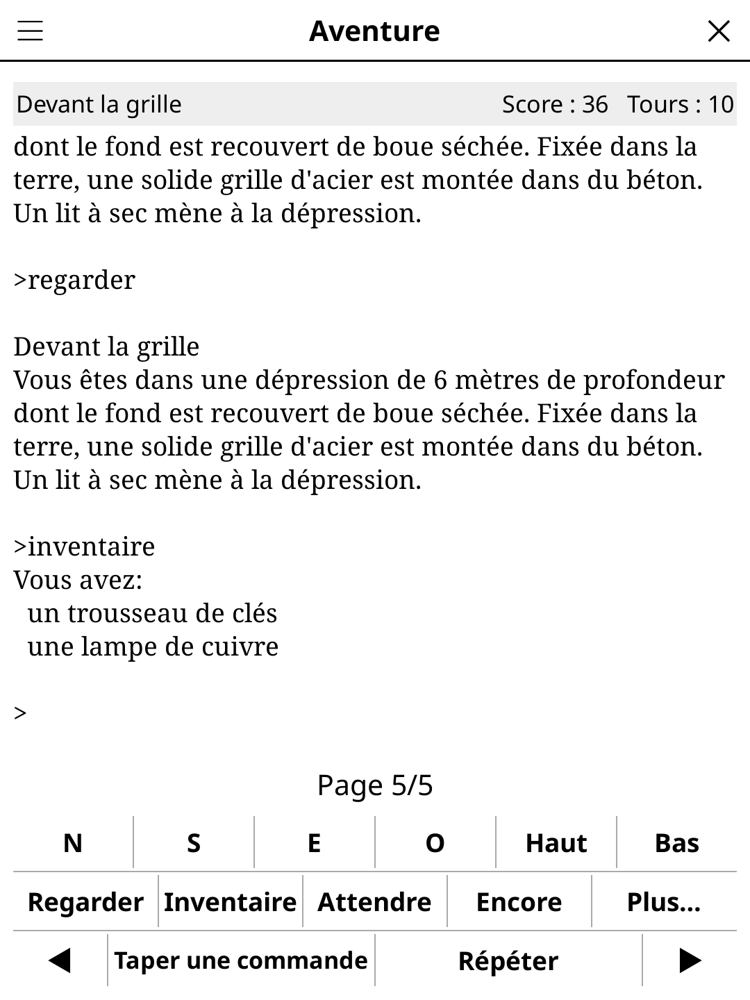

# textadventure.koplugin

**Text Adventures** (FR « Fictions interactives ») for [KOReader](https://github.com/koreader/koreader) —
a Z-machine interpreter, so you can play Infocom classics and the thousands of Inform games on your
e-reader. Pure Lua, no native code.

## Screenshot



## Getting stories

No story is bundled. Copy Z-code story files into **`koreader/data/textadventure/`** (the folder is
created the first time you open the game) and tap **Refresh**. Files placed in the plugin's own
`stories/` folder are listed too.

- Supported: `.z3`, `.z4`, `.z5`, `.z7`, `.z8`, and Blorb files (`.zblorb`, `.zlb`, `.blb`) — the
  story is taken out of the Blorb, pictures and sounds are ignored, and the iFiction title is used.
- Not supported: Glulx (`.ulx`, `.gblorb`), version 6 (graphical Infocom), TADS, Hugo, ADRIFT.
- **Where to find stories** (library menu, and a button on the empty library) lists recommended
  free stories in English and French — The Dreamhold, Lost Pig, 9:05, Photopia, Bronze, *Aventure*,
  *Le butin du Capitaine Verdeterre*… — each with its IF Archive file. Nothing is downloaded.
- Where to find them: [IFDB](https://ifdb.org), the
  [IF Archive](https://ifarchive.org/indexes/if-archive/games/zcode/); French stories on
  [fiction-interactive.fr](https://www.fiction-interactive.fr) and in the IF Archive's
  `games/zcode/french/` folder.

## Playing

- The story text scrolls like a book: tap the right side of the text (or swipe up, or the page-turn
  keys) for the next page, the left side (or swipe down) for the previous one. After each command the
  new text is shown from its start when it is longer than a page.
- **Type a command** opens KOReader's keyboard (long-press for accented letters). **History** in that
  dialog lists the last 30 commands; **Repeat** sends the last typed command again.
- Shortcut buttons: N S E W Up Down, Look, Inventory, Wait, Again, and **More…** (diagonals, In, Out,
  Undo, Score, Help). They send the story's own words — a French story gets `o`, `regarder`,
  `inventaire`… (detected from its dictionary).
- When the story waits for a single key (menus, "press any key"), the buttons become keys: Continue,
  Enter, ↑ ↓, N, P, Q, Escape, or **Key…** for any other.
- The status line is a grey band above the story, in a readable font: location on the left, score
  and turns on the right (on a second line when they don't fit). Taller upper windows (quote boxes,
  menus) keep the story's fixed-pitch layout.
- Title-bar menu: New game (start the story again), Font size, Save game, Restore game, Undo,
  Library, Rules.

## Multiplayer

*Text Adventures · multiplayer* (Tools → Games → Party & quiz, or menu →
*Mode*): lay the reader on the table and explore together.

- 2 to 8 players, names typed once and remembered. One is the **Commander**
  (shown in the status line; the keyboard asks "Alice, type a command"): the
  others suggest, the Commander sends the command.
- Command passes to the next player after every command, or every 2, 3 or 5
  (*Commander changes*); *Next commander* passes it by hand.
- Text is larger by default (26, up to 36). The table's story, autosave and
  font size are kept apart from the solo ones.

## Saving

- **Automatic**: the game is saved after every turn and when the screen closes. Open the plugin again
  (even after the reader was switched off) and you are back in the story at the same prompt, with the
  scrollback.
- **Your own saves**: SAVE / RESTORE in the story (or the menu) ask for a name; files go to
  `koreader/data/textadventure/saves/<story>/<name>.qzl` in the standard **Quetzal** format (the
  one Frotz and Gargoyle use; not yet cross-checked against them).
- UNDO works (several levels).

## Interpreter

`zmachine.lua` implements the Z-machine Standard 1.0 for versions 3, 4, 5, 7 and 8: all opcodes of
those versions, the object tree, dictionaries and tokenising, abbreviations, custom alphabets, the
Unicode translation table (ZSCII ↔ UTF-8 for accented letters, both ways), output stream 3,
`save_undo`/`restore_undo`, `catch`/`throw`, `read_char`. Memory is one FFI byte array (a 512 KB story
costs about 1 MB with its original copy).

Compliance (run headless with LuaJIT):

| Test suite | Result |
|---|---|
| CZECH 0.8 (`czech.z5`) | 425 tests: 406 passed, 0 failed, 19 print tests (visually correct) |
| Praxix (`praxix.z5`) | all tests passed (its 1.1 and 1.2 sections skip themselves: the interpreter reports Standard 1.0) |

Also played: three builds of Adventure (`Advent.z5` Inform, `advent.z3` ZIL, `advent.z8`), Dreamhold, Lost Pig, Bronze (Inform 7), and the
French *Aventure* and *Le butin du Capitaine Verdeterre* (zblorb).

Not implemented (allowed by the Standard): sound, colours, fonts, text styles (bold/italic are
shown as plain text), timed input (timers never fire: the story simply waits), transcript and
command-file streams, version 6.

## Speed

Infocom and Inform 6 turns run a few thousand Z-machine instructions — instant. Inform 7 games can
run two million or more per turn: about 0.05 s on a desktop, so expect up to a second or two per
turn on an older e-reader.

## Tests

```
LUA_PATH="<path to a bit module>/?.lua;;" busted test_zmachine_spec.lua test_library_spec.lua
```

The specs assemble tiny story images by hand: arithmetic and sign handling, shifts, branches,
loops, calls (v3 and v5 locals, argument count, catch/throw), indirect stack references, the object
tree and properties, text with abbreviations and escapes, stream 3, v3/v5 input and tokenising,
accented input, read_char, Quetzal save/restore/resume, undo, the v3 status line, Blorb parsing.

## License

GPL-3.0 — see [LICENSE](LICENSE).
